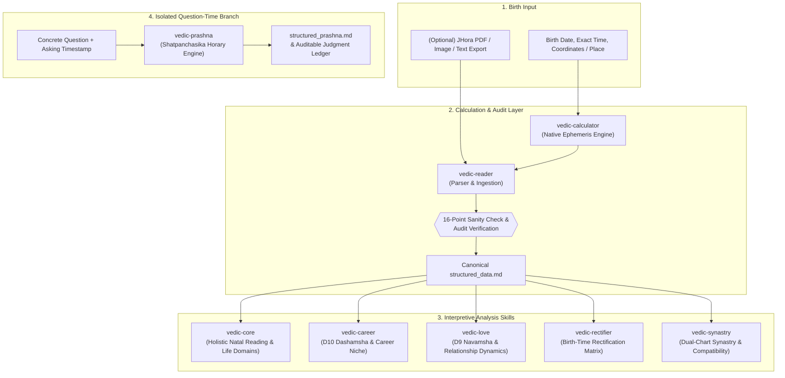

# Vedic Astro Skills (English Edition)

> **A professional, high-precision Vedic Astrology (Jyotish) calculation engine and multi-agent skill suite running natively in pure English.**

[](CHANGELOG.md)
[](#environment--setup)
[](LICENSE)
[](#engine-architecture)
[](#testing--verification)

---

## 🌟 Overview

**Vedic Astro Skills** is a comprehensive, offline-first Vedic astrology suite designed for AI agents (OpenAI Codex, Anthropic Claude Code, Antigravity) and human astrologers alike. 

Unlike conventional astrology software or basic LLM prompt libraries that depend on online third-party chart APIs or manual PDF uploads, this suite provides **native, mathematically verified astronomical calculation directly from raw birth details** (Date, Time, Latitude, Longitude, Timezone).

The suite operates across an integrated pipeline of **8 specialized skills**—spanning natal casting, 16-point mathematical validation, holistic Parashari life audits, specialized career and relationship analytics, astronomical birth-time rectification, composite synastry, and question-time Prashna (Horary).

---

## ⚡ Key Highlights

- **Pure English Native Execution:** Standardized classical Sanskrit terminology (Grahas, Bhavas, Dashas, Vimsottari, Vargottama, Ashtakavarga) paired with idiomatic English astrological analysis.
- **Sub-Second Precision & Zero Drift:** High-precision planetary longitudes and house cusps computed via compiled C-extensions of the Swiss Ephemeris (`pysweph`), verified against Desktop JHora to 6 decimal places.
- **Parashara Mathematical Constants:** Rigorously enforced mathematical invariants, including exact Sarvashtakavarga (SAV = 337) and true nodal opposition ($\Delta = 180.0000^\circ$).
- **Strictly Offline & Private:** Operates entirely locally. Zero telemetry, zero external network requests, zero data transmission of personal birth data.
- **Structured Data Contract:** A canonical, immutable markdown schema (`structured_data.md`) bridges the calculation engine and all downstream interpretive analysis.

---

## 🔄 End-to-End Workflow Architecture



---

## 🧩 The 8 Integrated Skills

| Skill | Primary Input | Core Responsibilities | Key Artifact |
|---|---|---|---|
| [`vedic-calculator`](skills/vedic-calculator/SKILL.md) | Birth date, time, coordinates, timezone | Native Swiss Ephemeris calculations: Graha longitudes, D9/D10/D1-D60 vargas, Ashtakavarga, Shadbala, 3-tier Vimshottari timelines. | `structured_data.md` |
| [`vedic-reader`](skills/vedic-reader/SKILL.md) | Calculated data, raw text, or JHora PDF | Extracts, normalizes, executes the 16-point sanity audit, assesses time-sensitivity, and routes to analysis modules. | Validated `structured_data.md` |
| [`vedic-core`](skills/vedic-core/SKILL.md) | Validated `structured_data.md` | Executes the P1-P12 planetary audit, PAC analysis (Position-Aspect-Conjunction), Raja/Dhana yoga evaluations, and 10 life domains. | Full Natal Report & Technical Appendix |
| [`vedic-career`](skills/vedic-career/SKILL.md) | Validated `structured_data.md` | Analyzes 10th house, 10th lord, Amatyakaraka (AmK), and D10 Dashamsha alignments to identify vocational niches and transit windows. | Career Profile & Strategy Dossier |
| [`vedic-love`](skills/vedic-love/SKILL.md) | Validated `structured_data.md` | Examines 7th house, Darakaraka (DK), Upapada Lagna (UL), and D9 Navamsha placements for partnership capacity and marriage timing. | Relationship Dynamics Dossier |
| [`vedic-rectifier`](skills/vedic-rectifier/SKILL.md) | Uncertain birth time + $\ge 5$ major life events | Compares candidate times against divisional boundary transitions, Dasha triggers, and transit confirmations to isolate true birth time. | Rectification Audit Log & Verdict |
| [`vedic-synastry`](skills/vedic-synastry/SKILL.md) | Two validated `structured_data.md` charts | Computes 36-point Ashtakavarga Koota screening, cross-chart Graha Drishti, mutual activation, and overlapping Dasha windows. | Composite Synastry Dossier |
| [`vedic-prashna`](skills/vedic-prashna/SKILL.md) | Concrete question, query timestamp, place | Pure question-time Horary chart using classical *Shatpanchasika* rules, isolated Tajika aspect analysis, and KP sub-lords. | `structured_prashna.md` & Ledger |

---

## 💻 Environment & Setup

### Prerequisites
- Python 3.8 to 3.13
- Git

### Installation

1. **Clone the repository:**
   ```bash
   git clone https://github.com/your-username/vedic-astro-skills.git
   cd vedic-astro-skills
   ```

2. **Set up the virtual environment:**
   ```bash
   cd skills/vedic-calculator
   python setup_env.py
   ```
   *This automated script sets up a virtual environment, installs `pysweph` (compiled C Swiss Ephemeris), `PyJHora`, timezone tools, and verifies the bundled `.se1` ephemeris files.*

3. **Verify the environment:**
   ```bash
   python check_env.py
   ```

---

## 🚀 Quick Start: Calculating a Natal Chart

Run the calculation engine directly from your terminal:

```bash
# Syntax: python engine.py YYYY-MM-DD HH:MM LATITUDE LONGITUDE TIMEZONE [--second SS] [--json]

# Example: Cast birth chart for June 12, 2003 at 17:27:00 (Gadag, Karnataka, India)
python skills/vedic-calculator/scripts/engine.py 2003-06-12 17:27 15.42 75.63 Asia/Kolkata
```

To output raw JSON for integration into pipelines or frontend applications:
```bash
python skills/vedic-calculator/scripts/engine.py 2003-06-12 17:27 15.42 75.63 Asia/Kolkata --json
```

---

## 🧪 Testing & Verification

The suite includes comprehensive automated regression suites covering astronomical precision, isolated horary logic, and cross-platform file integrity.

```bash
# 1. Run the Astronomical Engine Precision Suite (13 tests)
python skills/vedic-calculator/tests/test_engine_precision.py

# 2. Run the Prashna Horary Isolation Suite (12 tests)
python skills/vedic-prashna/tests/test_prashna_isolation.py

# 3. Verify Multi-Platform Cryptographic Skill Parity
python scripts/check_skill_parity.py
```

All suites verify:
- **Zero deviation** against benchmark JHora desktop printouts.
- **Exact Julian Day** conversion and timezone daylight saving edge cases.
- **Architectural isolation** guaranteeing no cross-contamination between Prashna and Natal pipelines.

---

## 📂 Repository Layout

```text
vedic-astro-skills/
├── README.md                          # Primary English documentation
├── CHANGELOG.md                       # Comprehensive version and release history
├── COMMERCIAL_NOTICE                  # Commercial licensing guidelines
├── LICENSE                            # GNU Affero General Public License (AGPL-3.0)
│
├── skills/                            # Canonical source distribution (8 skills)
│   ├── vedic-calculator/              # Swiss Ephemeris & PyJHora calculation engine
│   ├── vedic-reader/                  # Validation rules & intake contracts
│   ├── vedic-core/                    # Natal reading & domain synthesizers
│   ├── vedic-career/                  # Career & Dashamsha analytics
│   ├── vedic-love/                    # Navamsha & relationship frameworks
│   ├── vedic-rectifier/               # Birth-time rectification engine
│   ├── vedic-synastry/                # Dual-chart compatibility matrix
│   └── vedic-prashna/                 # Shatpanchasika Horary question engine
│
├── claude-code/skills/                # File-for-file mirror for Anthropic Claude Code
├── codex/skills/                      # Mirror for OpenAI Codex (includes agents/openai.yaml)
├── codex-patch/                       # Execution overlay and routing modules for Codex
├── build/anchored/                    # Indexed rule anchors and cross-reference hashes
└── scripts/
    └── check_skill_parity.py          # Cryptographic SHA-256 parity verification tool
```

---

## 🤖 Multi-Platform Agent Support

The repository is built to plug directly into leading AI agent environments:

- **Claude Code & Antigravity:** The `skills/` directory adheres to standard Skill specification formats with self-contained prompt templates and executable python scripts.
- **OpenAI Codex:** The `codex/skills/` distribution provides individual `agents/openai.yaml` descriptors, complemented by the specialized execution overlays in `codex-patch/`.

To synchronize changes across platforms after customizing any skill:
```bash
python skill_sync.py platforms
```

---

## ⚖ License & Disclaimer

- **Source Code:** Licensed under the [GNU Affero General Public License v3.0 (AGPL-3.0)](LICENSE).
- **Skill Definitions & Prompt Architecture:** Free for personal, academic, research, and non-commercial exploration. See [COMMERCIAL_NOTICE](COMMERCIAL_NOTICE) for commercial and hosted API deployment policies.
- **Astrological Disclaimer:** This software provides technical calculations and cultural interpretations based on classical Jyotish principles. It is intended for educational and self-reflective purposes and should not replace professional medical, legal, or financial counsel.
